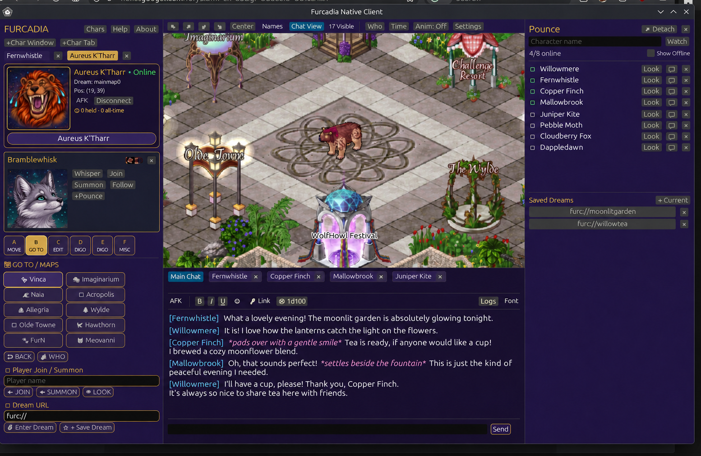

<div align="center">
  
  <h1>Furcadia Native Client</h1>
  <p><strong>A native desktop client for exploring Furcadia dreams, chatting, and keeping up with the people you know.</strong></p>
  <p>
    
    
    
    
  </p>
  <p>
    <a href="https://github.com/morganlowe/native-furcadia/releases">Releases</a>
    ·
    <a href="https://github.com/morganlowe/native-furcadia/issues">Report a Bug</a>
    ·
    <a href="https://github.com/morganlowe/native-furcadia/issues">Request a Feature</a>
    ·
    <a href="https://github.com/morganlowe/native-furcadia/security">Security</a>
  </p>
</div>

---



Furcadia Native Client is an independent desktop client for Furcadia, built in Rust with an `egui` interface. It includes a graphical client for everyday play, a command-line client for terminal workflows, and a reusable library for Furcadia networking and asset formats. The project targets Linux and Windows and is designed to use Furcadia data already present on your system.

## What you can do

### Explore dreams and play

- Connect to Furcadia, sign in with an account or character, and switch between characters and chat tabs.
- View dream maps with animated avatars, portraits, player names, and dream-specific skins.
- Join saved dreams or enter a `furc://` address; use map shortcuts and player actions to move around.
- Inspect player descriptions and use common actions such as whisper, join, summon, follow, pounce, cookie, and gift.

### Keep up with conversations

- Use main chat, emotes, whispers, clickable links, and character-colored names.
- Reorder character and whisper tabs, and open incoming whispers in their own tabs.
- Keep local chat and whisper logs, with configurable logging and retention.
- Follow characters with the Pounce watchlist and receive configurable notifications for pounces, whispers, and mentions.
- Read Furcadia news and review online status from the client.

### Bring your Furcadia files with you

Import maps, patches, portraits, settings, character details, Pounce lists, and logs from an existing Windows or Wine Furcadia installation. The importer searches common install and Documents locations, and you can also select a location from the client.

You can also sync this client's preferences and logs between computers with Nextcloud, Google Drive for desktop, Dropbox, or another app that syncs a local folder. No special account linking is needed in Furcadia Native Client: install your provider's app, then create or choose a dedicated folder inside its local synced area, such as `Nextcloud/Furcadia Native Sync/`. In the client, open **Settings → Logs**, select that folder, and click **Use Folder**. Choose the same synced folder on each computer; on additional computers, restart the client after connecting so it loads the newest shared preferences.

The client manages the contents of that folder: it creates `settings-<device>.ini` files at the top level and stores logs under `logs/<device>/` for each computer. The log viewer combines those per-device logs. Sync the whole **Furcadia Native Sync** folder, including its settings files and `logs` subfolder. Let the provider finish syncing before starting the client on another computer. Email, passwords, and auto-login credentials stay in each computer's local app settings.

The client reads Fox5 and FR01 asset archives and supports Furcadia map formats V01.40 and V01.50. Proprietary game files are not included in this repository; use files from your own Furcadia installation.

### Choose how to use it

- **GUI (`furc-gui`)** — the full desktop client, including dream view, chat, character selection, saved dreams, settings, and Pounce tools.
- **CLI (`furc-cli`)** — a terminal client for connecting, chatting, sending protocol commands, and monitoring watched characters.
- **Rust library (`furcadia_client`)** — networking, protocol messages, authentication, map and archive readers, world state, and related utilities.

## Get the client

Prebuilt packages are published on the [GitHub Releases page](https://github.com/morganlowe/native-furcadia/releases). Choose the asset for your operating system:

| Platform | Release asset |
| --- | --- |
| Windows 64-bit | `FurcadiaNative-Setup-<version>-x86_64.exe` |
| Debian, Ubuntu, Linux Mint | `furcadia-native_<version>_amd64.deb` |
| Arch Linux | `furcadia-native-<version>-1-x86_64.pkg.tar.zst` |

On Debian-based distributions, install the downloaded package with:

```sh
sudo apt install ./furcadia-native_<version>_amd64.deb
```

On Arch Linux, install the downloaded package with:

```sh
sudo pacman -U ./furcadia-native-<version>-1-x86_64.pkg.tar.zst
```

The Windows installer installs both client binaries and adds a Start Menu entry. Package contents and available platforms can vary by release; check the release notes for the current assets.

## Build from source

You will need the [stable Rust toolchain](https://www.rust-lang.org/tools/install). Linux builds also need the system development libraries required by `eframe`/`winit` for your desktop session (X11 or Wayland) and OpenGL.

```sh
git clone https://github.com/morganlowe/native-furcadia.git
cd native-furcadia
cargo build --release --bins
```

The binaries are written to `target/release/furc-gui` and `target/release/furc-cli`. To launch the graphical client, run `./target/release/furc-gui`.

## Command-line client

`furc-cli` connects to the default Furcadia server. Supply either a character name or an account email and a password:

```sh
./target/release/furc-cli --name CharacterName --password 'your-password'
```

```sh
./target/release/furc-cli --account you@example.com --password 'your-password' --watch FriendOne,FriendTwo
```

While connected, enter chat text directly or use `/wh NAME message`, `/who`, `/onln NAME`, `/glook NAME`, `/watch NAME`, `/unwatch NAME`, and `/pounce`. Prefix a protocol command with `/raw ` or a backtick. Run `furc-cli --help` for connection options such as `--host`, `--port`, and `--timeout-secs`.

## Data and privacy

Settings are stored locally at `~/.config/furcadia-native/config.ini` on Linux (or `%APPDATA%\furcadia-native\config.ini` on Windows). Chat logs are also stored locally. The client connects to Furcadia services for login, game sessions, news, and update checks; account login details are used to authenticate with Furcadia. On Unix-like systems the configuration file is written with owner-only permissions when possible. Avoid sharing your configuration file because it may contain saved credentials.

## Project status

This is an independent, actively developed client. Some behavior and asset support may differ from the official client, and compatibility can vary across dreams and installations. Please report reproducible problems through [GitHub Issues](https://github.com/morganlowe/native-furcadia/issues), including your operating system and the relevant log or error details. Do not attach account passwords or private credentials.

## Credits and license

The desktop interface uses [egui/eframe](https://github.com/emilk/egui). The project also uses `image` for PNG decoding, `lzma-rs` for LZMA decompression, and `bzip2-rs` for BZip2 data. See [`Cargo.toml`](Cargo.toml) for dependency details and their licenses.

Furcadia and its protocol and assets are associated with Dragon's Eye Productions, Inc. This is an independent community client and is not affiliated with or endorsed by Dragon's Eye Productions. It does not redistribute proprietary game assets.

This software is licensed under the [Creative Commons Attribution-NonCommercial-ShareAlike 4.0 International License](LICENSE). Commercial use is not permitted under this license.

<p align="center">
  
</p>
