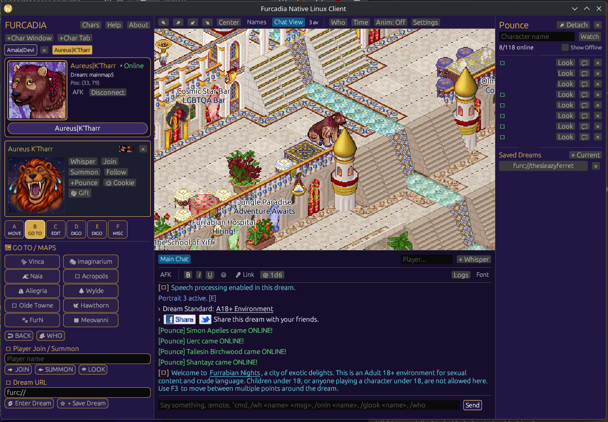

# Furcadia Native Client

A native, cross-platform client for Furcadia written in Rust (`furc-gui` and `furc-cli`). Designed for fast startup, low resource usage, and full support for modern Furcadia dreams and features on Linux and Windows.



## Features

- **Native GUI and CLI**: Hardware-accelerated interface built with `eframe` / `egui`, plus a standalone `furc-cli` binary.
- **Modern Dream & Avatar Rendering**: Supports Fox5/FR01 archives, dynamic avatars, digos, desctags, and custom portraits.
- **Chat, Emotes & Whispers**: Accent-colored player names in chat and emotes, drag-to-reorder character and whisper tabs, clickable links, and chat logging.
- **Player Interaction**: Live description viewer, Pounce watchlist, saved dreams, and quick actions (Whisper, Join, Summon, Follow, Cookie, Gift).
- **Asset Import**: Import maps, patches, portraits, and settings directly from an existing Furcadia installation.

## Installation

Prebuilt installers and packages are available on the [Releases](https://github.com/morganlowe/native-furcadia/releases) page.

### Windows

1. Download `FurcadiaNative-Setup-1.0.7-x86_64.exe` from the latest release.
2. Run the installer to install `furc-gui` and `furc-cli`, create a **Furcadia Native Client** Start Menu entry, and register a standard Windows uninstaller.

### Debian / Ubuntu / Linux Mint

Download `furcadia-native_1.0.7_amd64.deb` from the latest release and double-click it in your file manager, or install via terminal:

```sh
sudo apt install ./furcadia-native_1.0.7_amd64.deb
```

### Arch Linux

Download `furcadia-native-1.0.7-1-x86_64.pkg.tar.zst` from the latest release and install with:

```sh
sudo pacman -U furcadia-native-1.0.7-1-x86_64.pkg.tar.zst
```

Or build and install directly from the included `PKGBUILD`:

```sh
git clone https://github.com/morganlowe/native-furcadia.git
cd native-furcadia/packaging/arch
makepkg -si
```

## Building from Source

Requires Rust (stable) and, on Linux, X11/Wayland/OpenGL development libraries (`libxcb`, `libxkbcommon`, `libgl`).

```sh
git clone https://github.com/morganlowe/native-furcadia.git
cd native-furcadia
cargo build --release --bins
```

Binaries are written to `target/release/furc-gui` and `target/release/furc-cli`.

## Open Source Resources and Credits

- **eframe / egui** (MIT / Apache-2.0): Immediate-mode Rust GUI framework.
- **image** (MIT / Apache-2.0): PNG and image decoding.
- **lzma-rs** (MIT): LZMA decompression for Furcadia Fox5/FR01 archives.
- **Rust Standard Library** (MIT / Apache-2.0): Networking, filesystem, and concurrency primitives.
- **Furcadia**: Furcadia and its protocol/assets are copyright Dragon's Eye Productions, Inc. This client does not redistribute proprietary game assets and uses user-supplied local Furcadia files.

## License

Licensed under the Creative Commons Attribution-NonCommercial-ShareAlike 4.0 International License (CC BY-NC-SA 4.0). Non-commercial use only; this software may not be sold. See [LICENSE](LICENSE) for details.

---

<p align="center">
  
</p>
